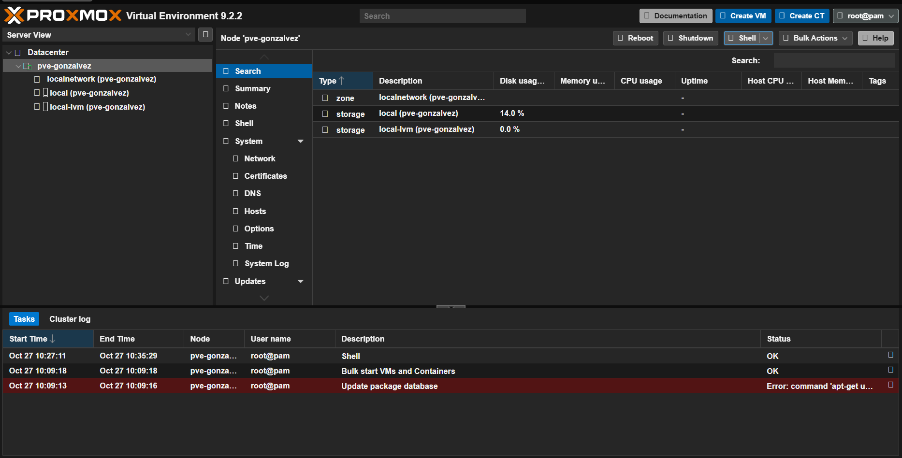
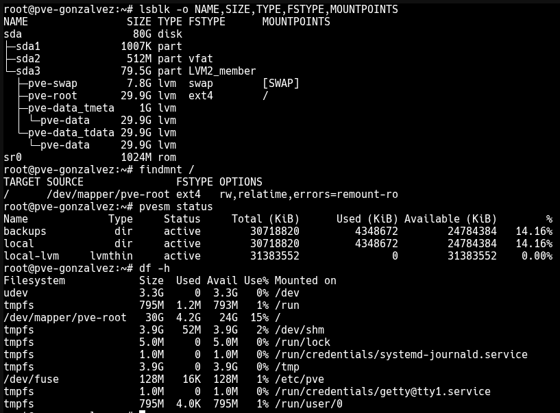
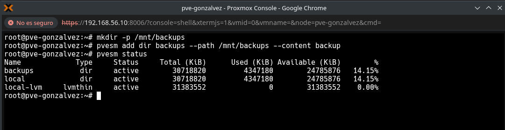
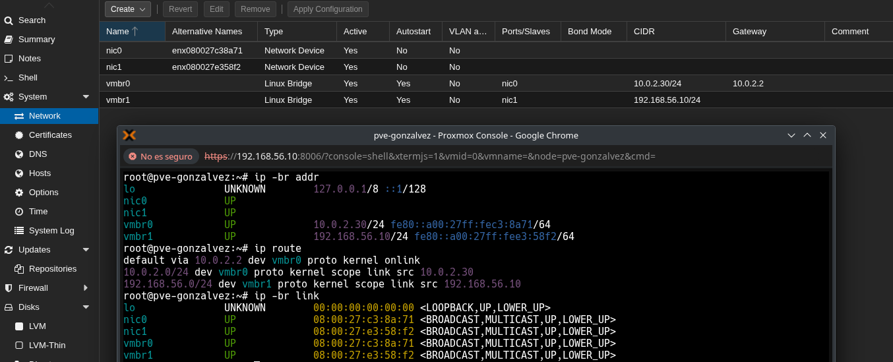
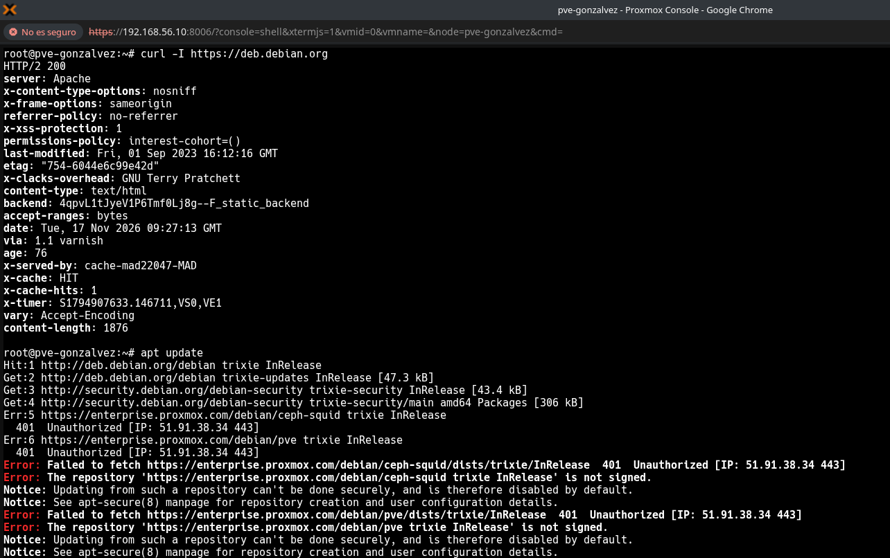
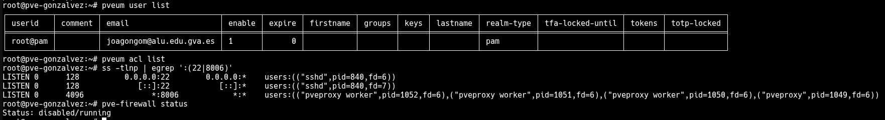
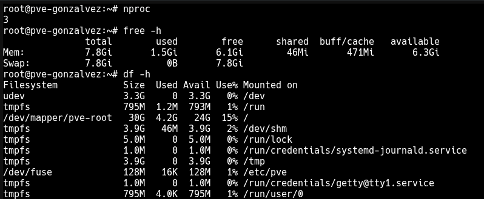

# 03-instalacion-proxmox

## Objetivo

Instalar Proxmox VE de forma virtualizada dentro de una máquina virtual de VirtualBox, comprobando que la virtualización anidada está disponible para el hipervisor.

## Procedimiento

| Paso | Acción |
|---|---|
| 1 | Abrir VirtualBox y registrar su versión: 7.1.2 |
| 2 | Crear la VM Linux de 64 bits pve-gonzalvez (3 CPU, 8 GB de RAM, disco VDI de 80 GB) |
| 3 | Reservar recursos para el sistema anfitrión |
| 4 | Configurar los adaptadores de red: NAT y solo-anfitrión |
| 5 | Con la VM apagada, habilitar la virtualización anidada y comprobar que funciona |
| 6 | Montar la ISO autorizada e instalar Proxmox VE dentro del VDI |
| 7 | Tras la instalación, entrar por la consola de la VM y editar /etc/network/interfaces para añadir, después del bloque de vmbr0, el bridge vmbr1 (tarjeta solo-anfitrión) con la IP 192.168.56.10/24 |

### Características de la máquina virtual

| Apartado | Valor |
|---|---|
| Nombre | pve-gonzalvez |
| Sistema operativo | Debian (64-bit) |
| Memoria base | 8192 MB |
| Procesadores | 3 |
| Orden de arranque | Disquete, Óptica, Disco duro |
| Aceleración | Paginación anidada, VT-x/AMD-V anidado, PAE/NX, paravirtualización KVM |
| Memoria de vídeo | 7 MB (controlador VMSVGA) |
| Almacenamiento | Controlador IDE, disco Proxmox_1.vdi (Normal, 80 GB), unidad óptica vacía |
| Audio | Controlador de anfitrión predeterminado, ICH AC97 |
| Red | Adaptador 1: PCnet-FAST III (NAT) |
| | Adaptador 2: PCnet-FAST III (solo-anfitrión, «VirtualBox Host-Only Ethernet Adapter») |
| USB | Controlador OHCI, EHCI (sin filtros) |
| Carpetas compartidas | Ninguna |
| Escritorio remoto / Grabación | Inhabilitados |

## Comandos usados

```bash
nano /etc/network/interfaces

ls /dev/kvm
egrep -c '(vmx|svm)' /proc/cpuinfo

hostnamectl,
ip -br addr,
pveversion,
df -h
```

## Evidencias

### Panel de Proxmox


### Red


### Almacenamiento


### Salida de comandos


## Conclusion

Se instaló Proxmox VE dentro de una VM de VirtualBox con 3 CPU, 8 GB de RAM y un disco de 80 GB, usando un adaptador NAT y otro solo-anfitrión. La práctica permitió comprender los requisitos de la virtualización anidada y cómo preparar el entorno para un hipervisor virtualizado.


# Fase 4. Configuración base del nodo

Comprobaciones realizadas desde la consola del nodo 'pve-gonzalvez' y desde el panel web, antes de crear las máquinas.

### Almacenamiento

Se revisó 'Datacenter -> Storage' y se contrastó con la consola:

```bash
lsblk -o NAME,SIZE,TYPE,FSTYPE,MOUNTPOINTS
findmnt /
pvesm status
df -h
```



| Almacenamiento | Backend | Ruta o pool real | Disco que lo sostiene | Contenido habilitado | Espacio disponible |
|---|---|---|---|---|---|
| local | Directorio | '/var/lib/vz', dentro del sistema de archivos raíz '/dev/mapper/pve-root' (ext4, 29.9 GB) | Disco VIrtual '/dev/sda' (80 GB, 'Proxmox_1.vdi'), partición sda3 (LVM), volumen lógico 'pve-root' | ISO, plantillas de contenedor y copias (según su configuración) | 23,6 GiB libres de 29,3 GiB (14,16 % usado)
| loval-lvm | LVM-thin |Grupo pve, thin pool pve-data (29,9 GB) | Disco virtual '/dev/sda', partición sda3 (LVM) | Discos de VM y volumenes de contenedor | 29,9 GiB libres de 29,9 GiB (0% usado) |
| backups | Directorio | '/mnt/backups', en el mismo sistema de archivos raíz que local | Disco virtual '/dev/sda' (pve-root) | Destino de los Backups | 23,6 GiB libres de 29,3 GiB (14,16 % usado) |

Para las copias se preparó un directorio propio y se añadió como almacenamiento.

```bash
mkdir -p /mnt/backups
pvesm add dir backups --path /mnt/backups --content backup
pvesm status
```

Comprobación: el almacenamiento 'backups' aparece como 'active'



**Espacio del anfitrión**: el disco virtual de proxmox es de 80 GB y puede crecer hasta ese tamaño. El espacio libre en la unidad del anfitrión donde está el VDI es de 146,5 GB.

**Riesgo**: las copias se guardan en el mismo disco que el laboratorio, por lo que un fallo de ese disco afectaría tanto a las máquinas como a sus copias.

### Interfaces y red

```bash
ip -b addr
ip route
ip -br link
```



|Interfaz / bridge | Adaptador de VirtualBox | Dirección | Función |
|---|---|---|---|
| nic0 / vmbr0 | Adaptador 1 (NAT) | 10.0.2.30/24, gateway 10.0.2.2 | Salida a Internet |
| nic1 / vmbr1 | Adaptador 2 (solo-anfitrion) | 192.168.56.10/24 | Red interna y gestión |

Comprobaciones de conectividad:

```bash
curl -I https://deb.debian.org
apt update
```



Resultado: el nodo resuelve nombres y tiene salida a Internet. 'apt update' mostro un error 401 con el repositorio 'enterprise', ya que no hay suscripción.

### Accesos administrativos

```bash
pveum user list
pveum acl list
ss -tlnp | egrep ':(22|8006)'
pve-firewall status
```


| Cuenta | Permisos | Usos |
|---|---|---|
| root@pam | Administrador completo del nodo | Administración del nodo por panel y SSH |

- Puertos en escucha: SSH (22/TCP, servicio sshd, en IPv4 e IPv6) y panel web (8006/TCP, servicio pveproxy), confirmado con 'ss -tlnp'.
- Firewall de Proxmox: desactivado ('pve-firewall status' indica disabled/running), sin reglas configuradas.
- Medidas de aislamiento del laboratorio: separación del tráfico mediante bridges independientes (vmbr0 para la salida externa por NAT y vmbr1 para la red interna solo-anfitrión).

### 4. Reparto de recursos

Recursos de la VM 'pve-gonzalvez' en VirtualBox: 3 CPU, 8192 MB de RAM y 80 GB de disco. Comprobados en el nodo con:

```bash
nproc
free -h
df -h
```



| Elemento | CPU/vCPU | RAM | Disco o almacenamiento | Motivo del reparto |
|---|---|---|---|---|
| Nodo Proxmox | Reserva (3 CPU de la VM, compartidas) | 2 GB (en reposo usa 1,5 GB) | ~38 GB: 30 GB de raíz ('pve-root`, 4,2 GB usados y 24 GB libres) y ~8 GB de swap | Poder administrar el nodo mientras servidor y cliente funcionan |
| srv-aso | 2 vCPU | 2 GB | 15 GB ('local-lvm') | Servicio principal del proyecto |
| cli-linux | 1 vCPU | 1,5 GB | 10 GB ('lovac-lvm') | Máquina de pruebas, con menos carga que el servidor |
Plantillas, ISO, copias y margen | n/a | 2,5 GB de margen | ~ 17 GB de margen en 'local-lvm'; ISO, plantillas y copias van a 'local/backups' (24 GB libres en la raíz) | Plantillas, ISO, copias y espacio libre |

- Recursos de la VM comprobados en el nodo: 'nproc' = 3 CPU, 'free -h' = 7,8 GiB de RAM (1,5 usados y 6,3 disponibles) y disco virtual de 80 GB.
- Total de RAM repartida: 8 GB (los 7,8 Gib que ve el nodo). Total de disco repartido: 80 GB.
- Las vCPU de las máquinas se comparten entre las 3 CPU de la VM.
- Reserva para el anfitrión: el equipo anfitrión (Linux) tiene 8 procesadores y 15 GiB de RAM. La VM usa 3 de los procesadores lógicos del equipo y 8 GB de su RAM, por lo que quedan 5 procesadores y unos 7 Gib de RAM para el sistema anfitrión.

[Volver al indice](../README.md)
