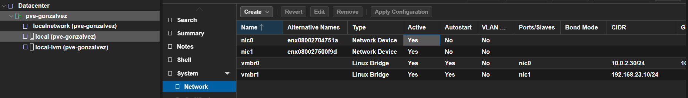
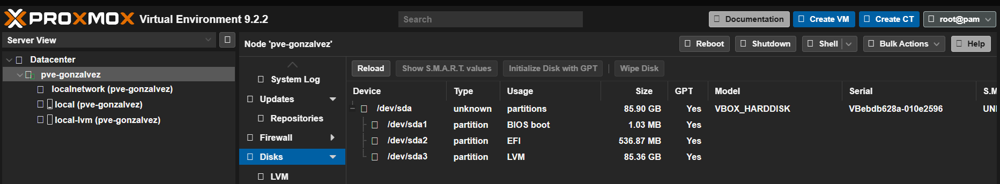
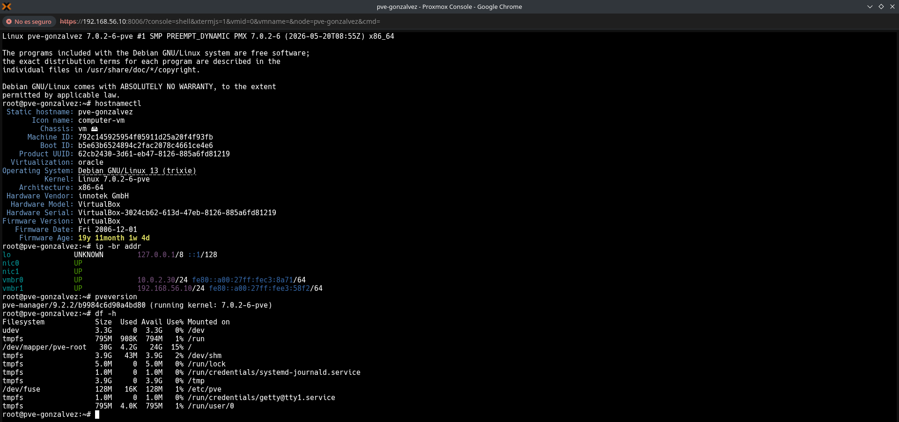

# 03-instalacion-proxmox

## Objetivo

Instalar Proxmox VE de forma virtualizada dentro de una máquina virtual de VirtualBox, comprobando que la virtualización anidada está disponible para el hipervisor.

## Procedimiento

| Paso | Acción |
|---|---|
| 1 | Abrir VirtualBox y registrar su versión: 7.1.2 |
| 2 | Crear la VM Linux de 64 bits pve-gonzalvez (3 CPU, 8 GB de RAM, disco VDI de 80 GB) |
| 3 | Reservar recursos para el sistema anfitrión |
| 4 | Configurar los adaptadores de red: NAT y solo-anfitrión |
| 5 | Con la VM apagada, habilitar la virtualización anidada y comprobar que funciona |
| 6 | Montar la ISO autorizada e instalar Proxmox VE dentro del VDI |
| 7 | Tras la instalación, entrar por la consola de la VM y editar /etc/network/interfaces para añadir, después del bloque de vmbr0, el bridge vmbr1 (tarjeta solo-anfitrión) con la IP 192.168.56.10/24 |

### Características de la máquina virtual

| Apartado | Valor |
|---|---|
| Nombre | pve-gonzalvez |
| Sistema operativo | Debian (64-bit) |
| Memoria base | 8192 MB |
| Procesadores | 3 |
| Orden de arranque | Disquete, Óptica, Disco duro |
| Aceleración | Paginación anidada, VT-x/AMD-V anidado, PAE/NX, paravirtualización KVM |
| Memoria de vídeo | 7 MB (controlador VMSVGA) |
| Almacenamiento | Controlador IDE, disco Proxmox_1.vdi (Normal, 80 GB), unidad óptica vacía |
| Audio | Controlador de anfitrión predeterminado, ICH AC97 |
| Red | Adaptador 1: PCnet-FAST III (NAT) |
| | Adaptador 2: PCnet-FAST III (solo-anfitrión, «VirtualBox Host-Only Ethernet Adapter») |
| USB | Controlador OHCI, EHCI (sin filtros) |
| Carpetas compartidas | Ninguna |
| Escritorio remoto / Grabación | Inhabilitados |

## Comandos usados

```bash
nano /etc/network/interfaces

ls /dev/kvm
egrep -c '(vmx|svm)' /proc/cpuinfo

hostnamectl,
ip -br addr,
pveversion,
df -h
```

## Evidencias

### Panel de Proxmox


### Red


### Almacenamiento


### Salida de comandos


## Conclusion

Se instaló Proxmox VE dentro de una VM de VirtualBox con 3 CPU, 8 GB de RAM y un disco de 80 GB, usando un adaptador NAT y otro solo-anfitrión. La práctica permitió comprender los requisitos de la virtualización anidada y cómo preparar el entorno para un hipervisor virtualizado.


# Fase 4. Configuración base del nodo

Comprobaciones realizadas desde la consola del nodo 'pve-gonzalvez' y desde el panel web, antes de crear las máquinas.

### Almacenamiento

Se revisó 'Datacenter -> Storage' y se contrastó con la consola:

```bash
pvesm status
df -h
```

Captura 1:

| Almacenamiento | Tipo | Contenido que admite | Espacio libre (KiB) | Uso |
|---|---|---|---|---|
| local | Directorio | Backup, Import, ISO image, Container template | 24786372 | Guardar las ISO de instalación y las plantillas de contenedores LXC |
| loval-lvm | LVM-thin | Disk image, Container | 31383552 | Guardar los discos de las máquinas srv-aso y cli-linux |
| backups | Directorio | Backups | 24785876 | Destino de los Backups |

Para las copias se preparó un directorio propio y se añadió como almacenamiento.

```bash
mkdir -p /mnt/backups
pvesm add dir backups --path /mnt/backups --content backup
pvesm status
```

Comprobación: el almacenamiento 'backups' aparece como 'active'

Captura 2: 

**Espacio del anfitrión**: el disco virtual de proxmox es de 80 GB y puede crecer hasta ese tamaño. El espacio libre en la unidad del anfitrión donde está el VDI es de 146,5 GB.

**Riesgo**: las copias se guardan en el mismo disco que el laboratorio, por lo que un fallo de ese disco afectaría tanto a las máquinas como a sus copias.

### Interfaces y red

```bash
ip -b addr
ip route
ip -br link
```

Captura 3:

|Interfaz / bridge | Adaptador de VirtualBox | Dirección | Función |
|---|---|---|---|
| nic0 / vmbr0 | Adaptador 1 (NAT) | 10.0.2.30/24, gateway 10.0.2.2 | Salida a Internet |
| nic1 / vmbr1 | Adaptador 2 (solo-anfitrion) | 192.168.56.10/24 | Red interna y gestión |

Comprobaciones de conectividad:

```bash
curl -I https://deb.debian.org
apt update
```

Captura 4:

Resultado: el nodo resuelve nombres y tiene salida a Internet. 'apt update' mostro un error 401 con el repositorio 'enterprise', ya que no hay suscripción.

### Accesos administrativos

[Volver al indice](../README.md)
