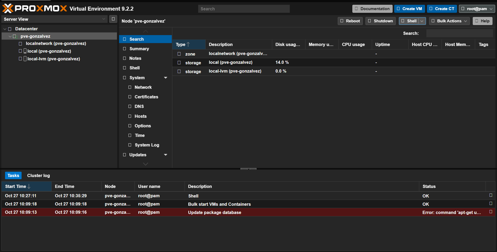
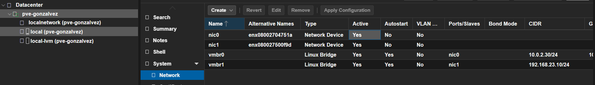
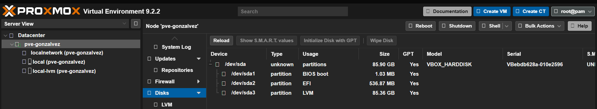
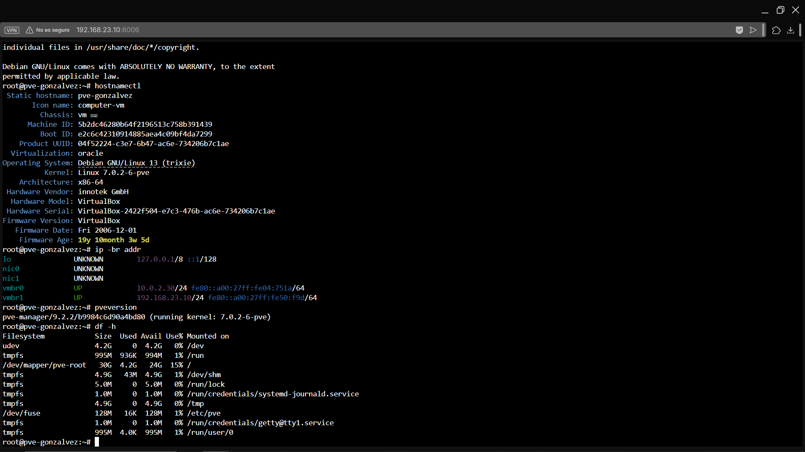

# 03-instalacion-proxmox

## Objetivo

Instalar Proxmox VE de forma virtualizada dentro de una máquina virtual de VirtualBox, comprobando que la virtualización anidada está disponible para el hipervisor.

## Procedimiento

| Paso | Acción |
|---|---|
| 1 | Abrir VirtualBox y registrar su versión: 7.1.2 |
| 2 | Crear la VM Linux de 64 bits pve-gonzalvez (6 CPU, 10 GB de RAM, disco VDI de 80 GB) |
| 3 | Reservar recursos para el sistema anfitrión |
| 4 | Configurar los adaptadores de red: NAT y solo-anfitrión |
| 5 | Con la VM apagada, habilitar la virtualización anidada y comprobar que funciona |
| 6 | Montar la ISO autorizada e instalar Proxmox VE dentro del VDI |
| 7 | Tras la instalación, entrar por la consola de la VM y editar /etc/network/interfaces para añadir, después del bloque de vmbr0, el bridge vmbr1 (tarjeta solo-anfitrión) con la IP 192.168.23.10/24 |

### Características de la máquina virtual

| Apartado | Valor |
|---|---|
| Nombre | pve-gonzalvez |
| Sistema operativo | Debian (64-bit) |
| Memoria base | 10240 MB |
| Procesadores | 6 |
| Orden de arranque | Disquete, Óptica, Disco duro |
| Aceleración | Paginación anidada, VT-x/AMD-V anidado, PAE/NX, paravirtualización KVM |
| Memoria de vídeo | 7 MB (controlador VMSVGA) |
| Almacenamiento | Controlador IDE, disco Proxmox_1.vdi (Normal, 80 GB), unidad óptica vacía |
| Audio | Controlador de anfitrión predeterminado, ICH AC97 |
| Red | Adaptador 1: PCnet-FAST III (NAT) |
| | Adaptador 2: PCnet-FAST III (solo-anfitrión, «VirtualBox Host-Only Ethernet Adapter») |
| USB | Controlador OHCI, EHCI (sin filtros) |
| Carpetas compartidas | Ninguna |
| Escritorio remoto / Grabación | Inhabilitados |

## Comandos usados

nano /etc/network/interfaces

ls /dev/kvm
egrep -c '(vmx|svm)' /proc/cpuinfo

hostnamectl
ip -br addr
pveversion
df -h

## Evidencias

### Panel de Proxmox

### Red

### Almacenamiento

### Salida de comandos

## Incidencias

- El instalador indicaba que no había soporte de virtualización por hardware (KVM).** Se debía a que la virtualización anidada no llegaba a la VM.
- /dev/kvm no existía en el nodo..

## Conclusion

Se instaló Proxmox VE dentro de una VM de VirtualBox con 6 CPU, 10 GB de RAM y un disco de 80 GB, usando un adaptador NAT y otro solo-anfitrión. La práctica permitió comprender los requisitos de la virtualización anidada y cómo preparar el entorno para un hipervisor virtualizado.

[Volver al indice](../README.md)
